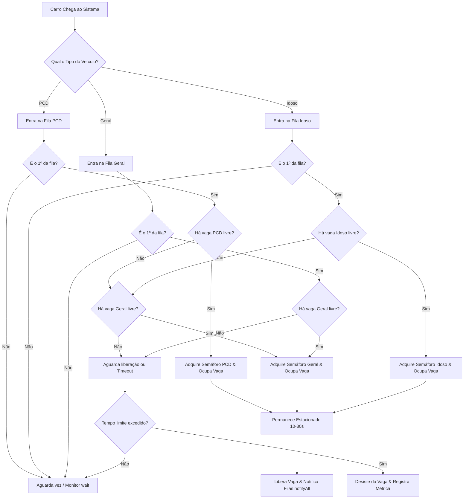

# 🚗 Smart Parking System — Simulação Concorrente Multithread

<p align="center">
  
  
  
  
</p>

> **Simulador de controle de vagas em tempo real para shopping centers**, desenvolvido em Java puro. O projeto implementa controle rigoroso de concorrência, filas prioritárias com fallback, semáforos contadores, prevenção de *race conditions* e monitoramento gráfico interativo via Java Swing sem bloqueio da Event Dispatch Thread (EDT).

---

## 🎯 Visão Geral & Problema de Engenharia

O gerenciamento de recursos compartilhados com alta demanda em sistemas de tempo real apresenta desafios clássicos da Ciência da Computação: **concorrência**, **acesso a regiões críticas**, **condições de corrida (*race conditions*)**, **inanição (*starvation*)** e **impasses (*deadlocks*)**.

Este projeto simula o ecossistema de um estacionamento inteligente, onde múltiplos veículos (representados por *Threads* autônomas) disputam vagas físicas categorizadas sob regras rígidas de prioridade e tempo de tolerância.

### 💼 Competências Técnicas Demonstradas

| Área | Tecnologias / Práticas Aplicadas |
| :--- | :--- |
| **Multithreading & Concorrência** | `Thread`, `Runnable`, `ExecutorService` (`CachedThreadPool`), ciclo de vida de threads e cancelamento cooperativo (`interrupt`). |
| **Sincronização & Regiões Críticas** | `Semaphore` (controle de capacidade por setor), blocos `synchronized`, monitores com `wait()` e `notifyAll()`. |
| **Thread Safety & Atomicidade** | `AtomicInteger` para contadores de métricas com consistência garantida sem overhead de locks desnecessários. |
| **Arquitetura & Clean Code** | Separação em camadas (`model`, `UI`, `util`, `app`), polimorfismo, enums tipados e uso de `Optional` para evitar `NullPointerException`. |
| **UI Reativa & Event-Driven** | Interface Swing com `WrapLayout` dinâmico, atualização desacoplada via `SwingUtilities.invokeLater` (garantindo que a interface nunca trave durante a simulação). |

---

## ⚙️ Regras de Negócio & Algoritmo de Alocação

O estacionamento possui uma capacidade total configurável $X$, distribuída em três categorias:

$$X = X_{PCD} + X_{Idoso} + X_{Geral}$$

### 🔀 Fluxo de Decisão e Priorização



1. **Vagas PCD:** Exclusivas para condutores PCD. Caso todas estejam ocupadas, o veículo pode ocupar uma vaga **Geral** como alternativa.
2. **Vagas Idoso:** Exclusivas para condutores Idosos. Caso todas estejam ocupadas, o condutor também tem permissão para ocupar uma vaga **Geral**.
3. **Vagas Gerais:** Destinadas ao público geral ou ao excedente de PCD e Idosos. Carros comuns **não** podem ocupar vagas preferenciais.
4. **Política FIFO com Prevenção de Starvation:** Cada categoria possui sua própria fila de espera. Uma thread aguarda sua vez na frente da fila (`minhaFila.peek() == carro`) antes de tentar disputar a vaga, evitando que novos veículos passem à frente de veículos antigos.
5. **Mecanismo de Desistência por Timeout:** Veículos que aguardam por mais tempo que o limite de tolerância estipulado abortam a tentativa, desocupam a fila de espera e incrementam a métrica de desistência.

---

## 🏗️ Arquitetura do Sistema e Concorrência

```
┌─────────────────────────────────────────────────────────────┐
│                      EstacionamentoGUI                      │
│   (Thread de Interface Gráfica - Event Dispatch Thread)     │
└──────────────┬──────────────────────────────▲───────────────┘
               │ Dispara Simulação            │ Atualizações
               ▼                              │ via invokeLater()
┌─────────────────────────────────────────────┴───────────────┐
│                       Estacionamento                        │
│  ├── Semaphore (Geral, Idoso, PCD)                          │
│  ├── Queue<Carro> (Filas FIFO sincronizadas)                │
│  ├── List<Vagas> (Região crítica protegida)                 │
│  └── AtomicInteger (Contadores thread-safe)                 │
└──────────────────────────────▲──────────────────────────────┘
                               │
               Disputa de vagas por múltiplas threads
                               │
          ┌────────────────────┴────────────────────┐
          │                                         │
┌──────────────────┐                      ┌──────────────────┐
│   Thread: Carro  │                      │   Thread: Carro  │
│    (Runnable)    │      ...             │    (Runnable)    │
└──────────────────┘                      └──────────────────┘
```

### 🔒 Estratégias de Sincronização

* **Controle de Capacidade via Semáforos (`Semaphore`):** Cada tipo de vaga conta com um semáforo com número de permissões equivalente ao total de vagas do tipo. A aquisição utiliza `tryAcquire()` não-bloqueante coordenado com a fila de prioridades.
* **Acesso Atômico às Vagas Físicas:** A atribuição de um carro a um objeto `Vagas` específico ocorre dentro de blocos `synchronized(this)`, prevenindo que dois veículos recebam o ponteiro da mesma vaga física.
* **Coordenação Produtor-Consumidor (`wait` / `notifyAll`):**
  * Ao desocupar uma vaga PCD ou Idoso, o sistema notifica especificamente a fila correspondente.
  * Ao desocupar uma vaga Geral, todas as três filas são notificadas, pois qualquer categoria pode aproveitá-la.
* **Pool Dinâmico de Threads (`CachedThreadPool`):** O `ExecutorService` aloca e reutiliza threads sob demanda para simular o tráfego contínuo ou o lote único de veículos.

---

## 🖥️ Recursos da Interface Gráfica (Swing)

* **Grid de Vagas com Feedback Visual:**
  * 🟩 **Verde:** Vaga livre e disponível.
  * 🟥 **Vermelho:** Vaga ocupada, exibindo identificador da vaga e a placa do veículo em tempo real.
* **WrapLayout Responsivo:** Reorganiza a matriz de vagas automaticamente conforme a janela é redimensionada.
* **Painel de Configuração Dinâmica:** `JSpinner` para definir quantidades de vagas e carros de cada tipo antes de iniciar o teste.
* **Modo Ciclo Único vs. Contínuo:** Opção de executar cada carro uma única vez ou mantê-los retornando ciclicamente.
* **Painel de Filas em Tempo Real:** Visualização nominal dos veículos na fila de espera com suas respectivas categorias.
* **Console de Logs com Separação de Níveis:**
  * **Eventos Principais:** Entradas, saídas e desistências.
  * **Todos os Eventos:** Detalhamento completo para auditoria e rastreamento de threads.

---

## 📂 Estrutura do Repositório

```text
Estacionamento_Shopping/
├── src/
│   └── estacionamento/
│       ├── app/
│       │   └── Main.java              # Ponto de entrada (Bootstrapping da aplicação na EDT)
│       ├── model/
│       │   ├── Carro.java             # Entidade ativa (Runnable / Thread com ciclo de vida)
│       │   ├── Estacionamento.java    # Monitor central, semáforos, filas e lógica de entrada/saída
│       │   └── Vagas.java             # Entidade de vaga física com travas synchronized
│       ├── UI/
│       │   ├── EstacionamentoGUI.java # Janela principal, orquestração e monitoramento visual
│       │   ├── VagaPanel.java         # Componente gráfico individual para renderização da vaga
│       │   └── WrapLayout.java        # Layout manager personalizado para grid fluido
│       └── util/
│           └── TipoVaga.java          # Enum com categorias de vagas (PCD, IDOSO, GERAL)
├── .gitignore
└── README.md
```

---

## 🚀 Como Executar

### Pré-requisitos
* **Java Development Kit (JDK):** Versão 17 ou superior (compatível a partir do Java 8).
* **Git** instalado no sistema.

### 1. Clonar o repositório
```bash
git clone https://github.com/LucaS4nt0s/Estacionamento_Shopping.git
cd Estacionamento_Shopping
```

### 2. Compilar via Linha de Comando
```bash
# Criar diretório de saída
mkdir bin

# Compilar todos os arquivos fonte
javac -d bin -sourcepath src src/estacionamento/app/Main.java

# Executar a aplicação
java -cp bin estacionamento.app.Main
```

### 3. Executar via IDE (IntelliJ IDEA / Eclipse / VS Code)
1. Abra a pasta do projeto como projeto Java existente.
2. Certifique-se de que a pasta `src` está marcada como **Sources Root**.
3. Localize o arquivo `src/estacionamento/app/Main.java`.
4. Clique em **Run 'Main'**.

---

## 🧪 Cenários de Teste Sugeridos (Avaliação Técnica)

Para validar a integridade dos algoritmos de sincronização, execute os seguintes cenários na interface:

1. **Teste de Sobrecarga e Concorrência Massiva:**
   * Configure `Vagas: 10 Gerais, 3 Idosos, 2 PCD` e `Carros: 40 Gerais, 15 Idosos, 10 PCD`.
   * **Comportamento esperado:** Nenhuma vaga é ocupada em duplicidade; filas enchem sem interrupção abrupta e os excedentes desistem após o timeout sem gerar vazamento de memória ou travamento.
2. **Teste de Fallback Prioritário:**
   * Configure `Vagas PCD: 0`, `Vagas Idosos: 0`, `Vagas Gerais: 10`.
   * Insira apenas carros PCD e Idosos.
   * **Comportamento esperado:** Veículos prioritários identificam a ausência de vagas exclusivas e ocupam com sucesso as vagas gerais.
3. **Teste de Encerramento Limpo (Graceful Shutdown):**
   * Durante uma simulação ativa com fila cheia, clique em **Parar Execução**.
   * **Comportamento esperado:** O `ExecutorService` cancela as threads ativas via interrupção cooperativa, esvazia as filas e reabilita os controles da interface sem exceções não tratadas no console.

---

## 👥 Autores

* **Luca Samuel dos Santos** — [GitHub](https://github.com/LucaS4nt0s) | [LinkedIn](https://www.linkedin.com/in/lucas-santos-dev)
* **Maria Eduarda Batista Henrique** — [GitHub](https://github.com/MariaEduardaBatt)

---

<p align="center">
  Desenvolvido como projeto prático de Computação Concorrente & Sistemas Operacionais.
</p>
